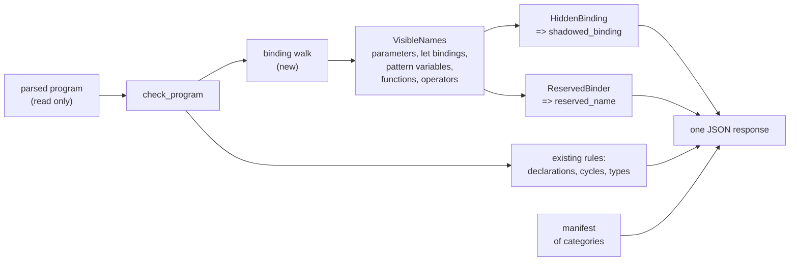

# F5 design: who owns the binding rules

## The question this answers

Where do the three rules live, and what do they read, so that no other
part of the checker has to change?

## Decision

One new walk in `src/prova/checker.py`, placed beside the rules F2, F3
and F4 added there, with three small values of its own:

- **VisibleNames** — the names in scope where a binding is introduced,
  each with what introduced it: a parameter, an enclosing `let` binding,
  a pattern variable of the same pattern, a declared function or a
  builtin operator. It answers what a new binder would hide, and it
  gives a fresh scope for a clause or a `let` body.
- **HiddenBinding** — one binder that took a visible name. It carries
  the `shadowed_binding` refusal, which names the binder, what it hides
  and where it is written.
- **ReservedBinder** — one binder that used `result`. It carries the
  `reserved_name` refusal.

Nothing else changes. The type inference keeps deciding types, the
response shape keeps its `category`, `reason` and `location`, and
`src/prova/syntax.py` is only read, because feature F6 is working there.
The tool's manifest gains the two new category names, as F3 and F4 each
did for theirs.

**Why not reuse the existing owners.** The environment the type
inference threads maps a name to its *type*, which cannot say
"parameter" or "function", so it cannot carry a refusal that names what
was hidden. The duplicate-declaration rule reads top-level declarations
only and never sees a local binder.

**What the choice costs.** The parsed program is walked once more, and
the names a pattern binds are collected in two places for two different
questions (which names, with their types, for the inference; which
names, in order, for this rule). The alternative — widening the
inference environment to carry the origin of every name — would have
touched every branch of `_infer` and every existing diagnostic path, for
a rule that decides no type.

**No formal model.** The rules are a pure function of one parsed
program: no shared state, no multi-step protocol, no concurrency and no
crash window. Three generated properties carry the laws instead (binder names,
clause counts, nesting depth), each with its bounds written down; they
sample a universal claim within those bounds rather than prove it.

**No prefactoring.** The new walk is added beside the existing ones; no
existing function changes its signature, its result or its behaviour.

## Diagram: what each rule reads before it refuses

**Legend.** Boxes are units of the tool; an arrow means "reads" or
"produces". "(new)" marks what this feature adds; every other box
already exists.

**Text equivalent.** `check_program` reads the parsed program and runs
the existing rules about declarations, function cycles and types. This
feature adds one more walk beside them. That walk builds, at every
binder, the set of visible names with what introduced each one; from it,
a binder that takes a visible name becomes a `shadowed_binding` refusal
and a binder named `result` becomes a `reserved_name` refusal. Those
refusals join the existing ones in the single JSON response, and both
new category names are published in the manifest.

## Invariants the change must keep

| | Invariant |
|---|---|
| INV1 | Every refusal names the binder, what it hides, and the line and column of the binder. |
| INV2 | A binder is refused as reserved exactly when it introduces `result`; reading `result` where nothing binds it stays an unbound name. |
| INV3 | A pattern variable is visible only in its own clause; the variables of one pattern are visible to each other, so a repeat is refused. |
| INV4 | Every category this rule can answer with is published by the manifest. |
| INV5 | No type decision and no other refusal changes: a program that breaks none of these rules gets the answer it gets today. |

## Still open

The code is not written. The exact wording of the two refusals is
written with the rule; the oracle fixes only what they must name.
