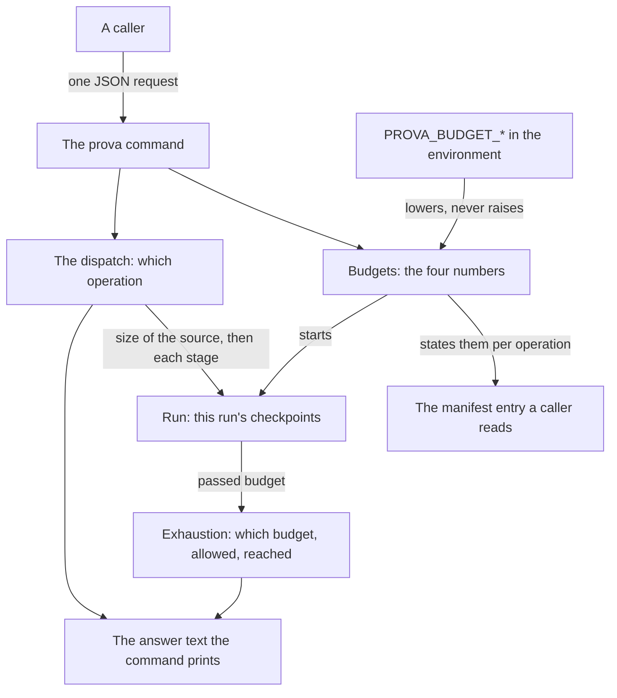

# Budgets: the design

## The question this design answers

Who owns each of the four numbers, and where is a run measured against them?

## Who owns what

| Rule | Owner |
|---|---|
| How large a source this tool reads, how long a run may take, how much memory it may take, how large an answer may be | `src/prova/budgets.py`, new |
| Whether a budget a caller lowered can be read at all | `src/prova/budgets.py`, from the environment the command hands it |
| The status a passed budget is answered with | `src/prova/service.py`, the `resource_exhausted` the two older limits already use |
| What a refusal of each new category carries | `src/prova/checker.py`, the one table of published shapes |
| The block the manifest states the limits in | `src/prova/service.py`, where the budgets join the nesting limit and the evaluation depth |
| The text of the one answer the command prints | `src/prova/service.py`, a new `answer_text` the command calls |
| How deeply a text may nest, how far a run may stand inside itself | `src/prova/reader.py` and `src/prova/evaluator.py`, untouched |

A new module was created rather than extending an old one because the two limits
this tool already has live where the work they limit happens: nesting lives in the
reader because the reader is what nests, and evaluation depth lives in the
evaluator for the same reason. A budget over the whole run belongs to neither, and
putting four numbers in the dispatcher would make it the owner of four rules it
does not apply -- in the one file another delivery is editing at the same time.

## Where a run is measured

**Legend.** A box is a thing that owns something; an arrow is one thing asking
another. `Budgets` owns the four numbers; `Run` owns one run's measurements;
`Exhaustion` owns what a refusal says. Nothing in the diagram stores anything
between runs.

**The same in words.** The command reads the environment once, lowers any budget
a caller asked to lower, and hands the four numbers to the dispatch, which starts
a run. The run is asked at each boundary -- before the source is read, after it is
read, after it is checked, and before each declared example -- whether the time or
memory budget has been passed; the size of the source is compared against the
input budget before any rule of the language is read over it. If a budget was
passed, the run answers which one, what it allowed and what was reached, and that
becomes the whole answer. Otherwise the operation's own answer is rendered, and
the answer budget is applied to the text that would be printed. The same four
numbers are what the manifest states, so what a caller reads and what the tool
enforces cannot drift apart.

## What the design must keep

| | Invariant | Where it is kept |
|---|---|---|
| INV1 | A budget refusal reports the budget, its maximum and the amount reached, and nothing about the program | `Exhaustion` has no field for a claim, a result or a digest |
| INV2 | The number stated is the number enforced | The manifest entry and the check read the same object |
| INV3 | The environment may only lower a budget; anything else is refused by name | `Budgets` reads the environment in one place |
| INV4 | Every printed answer is one complete answer or one refusal; never a cut-short answer | `service.answer_text` |
| INV5 | The memory budget claims only what it read | `PeakMemory` says whether this platform can report it |
| INV6 | The two older limits keep their numbers and their place | The budgets join the same block in `_run_discover` |
| INV7 | This tool reads at most the input budget plus a stated allowance of any request before it answers, so a request too large to answer is never held in memory whole | `__main__._read_at_most` |

## How much of a request is read at all

The input budget sizes the source a request carries, and a request carries more
than its source: the operation, an evaluate request's function and arguments, and
the JSON around them. A tool that read all of that before sizing anything would
spend the memory the budgets exist to hold down -- a 200 MiB request cost 654 MB
to refuse, past the 512 MiB this tool declares for itself.

So the command reads one character past `input_size` plus a stated allowance of
**65536 bytes** for everything a request carries around its source, and answers a
longer request against the input budget without reading it. Both numbers are
stated in the manifest beside the budget, with the reason for the second. A
request refused this way says plainly that the operation asked for was never
read, because it was not: the answer names no operation.

The allowance is 64 KiB because the largest request this tool answers today is an
evaluate request of a few hundred bytes around its source, and because a page or
two is cheap to read and refuse. Like the four budgets, it was chosen, not
measured.

## Decisions and their cost

* **Four refusal categories, not one.** A caller handling "the source was too
  large" differently from "the run ran out of time" should not read prose to tell
  them apart. Cost: four entries in the published table instead of one.
* **The environment, lowering only.** The alternative, a field in the request,
  would let any caller rewrite the budgets of the published protocol; an argument
  inside the process could not be reached from a test that drives the real
  command. Cost: a new published surface, with three ways to get it wrong -- a
  name this tool does not publish, a value that is not a whole number, a value
  above the declared maximum -- each refused by name rather than ignored, because
  a caller that believed it had lowered a budget and had not would read the run
  that followed as proof that its work fits.
* **The answer budget is applied where the answer is written.** One owner for the
  bytes a caller reads. Cost: a caller inside this process that calls the
  dispatcher directly gets a dictionary and no answer budget; the command, which
  is the public port, always applies it.
* **Time and memory are observed between stages.** A stage already running is not
  interrupted part way; what keeps a stage short is the input budget. Cost:
  stated, not hidden -- the entry says where the budget is observed. Today no
  core-0 program can run without end anyway, because the checker refuses a cyclic
  call graph, so the profile has neither loop nor recursion.
* **No formal model.** No shared state, no protocol, no concurrency, no crash
  window: a budget is one number compared with another inside one process, and
  the four generated laws cover the comparison.
* **A platform that cannot report its own peak memory** gets an entry that says
  the memory budget is not enforced there and why, and no answer on such a
  platform ever says the budget was met (the Owner's decision, recorded).
* **No refactor first.** Every line this change touches keeps its behaviour. The
  one refactor this file has recorded as owed -- extracting the preamble the four
  handlers repeat -- is owed for a time when no other delivery is editing
  `service.py`, and one is editing it now.

## Still open

* The time and memory numbers remain declared, not measured; a CI measurement is
  owed before they can be called anything else.
* Nothing yet observes a run that passes a budget in the middle of a single stage,
  because no such run can be built from outside today.
