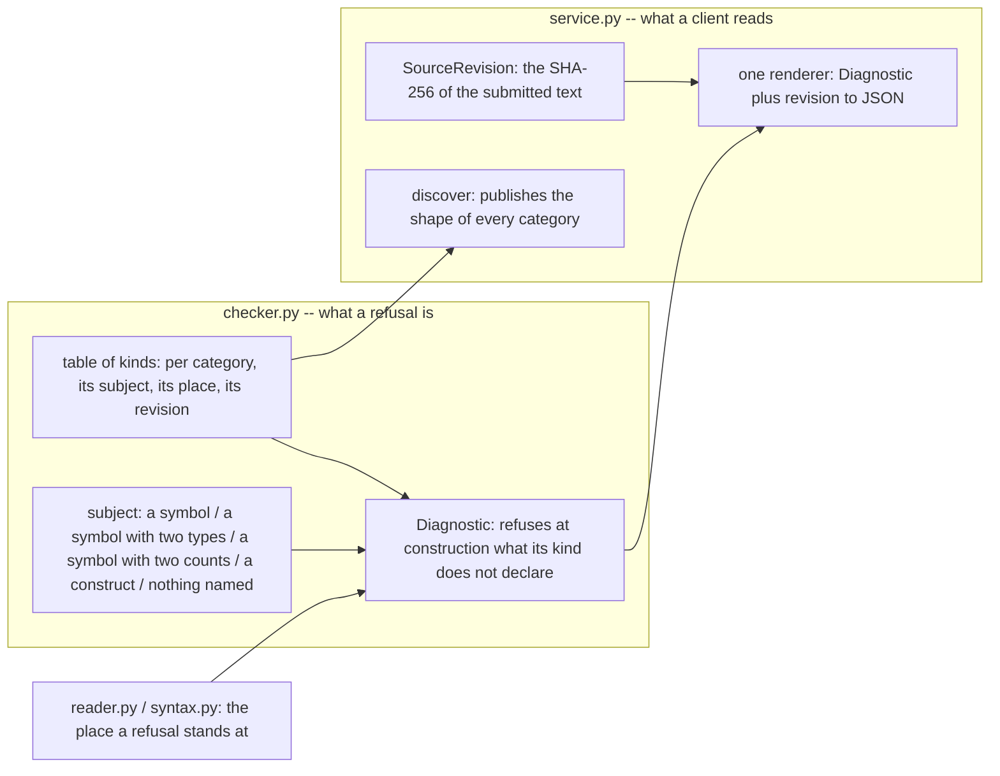

# F10, step 2: the design

## The question this design answers

Where is it decided what a refusal carries, so that it is decided once?

Today it is decided forty times. Each rule that refuses a program writes
its own sentence, and some of them also pass a place. Beside that,
`service.py` builds eight more refusals as plain dictionaries of its own.
Nothing says what a refusal of a given kind contains, so a client cannot
read the shape from the tool, and two refusals of the same kind can come
out differently shaped.

## The shape of the change

**Legend.** A box is a unit of code. An arrow means "is read by". The two
groups are the two files the request names. `reader.py` and `syntax.py`
appear as one box because both only supply places.

**In words.** One table says, for each diagnostic category, what a
refusal of that category is about, whether it is placed, what its place
points into, and whether it carries a revision. The `Diagnostic` type
reads that table when it is built and refuses anything the table does not
declare. One renderer in `service.py` turns a `Diagnostic` plus the
revision of the submitted text into the JSON a client reads. The same
table is what `discover` publishes, so the shape a client is promised and
the shape the tool builds cannot drift apart.

## What is reused, and what is new

Reused: `Diagnostic` stays the one type every refusal is. `DeclaredName`
in `syntax.py` keeps owning the place of a declared name, so the six
refusals that gain a place read the position the parser already recorded
instead of searching the text again. `ReaderError` keeps owning the place
the reader stopped at. The SHA-256 of a source is already computed in
`service.py`.

New: a small family of value objects for *what a refusal is about* (a
symbol; a symbol with an expected and an actual type; a symbol with two
counts; a named construct; nothing named), because no unit owns that
today and every site writes it into prose instead. One table of kinds,
because nothing says what a category carries. A `SourceRevision` value
object, because stamping every diagnostic is a responsibility and not a
calculation.

## The rules this design must keep

| | Rule | Where it is kept |
|---|---|---|
| INV1 | a refusal cannot be built with a subject its category does not declare, nor with an unpublished category | `Diagnostic`, at construction |
| INV2 | a refusal of a category declared placed cannot be built without a place | `Diagnostic`, at construction |
| INV3 | every refusal about a submitted source carries the revision of that exact text | the one renderer |
| INV4 | the published shape and the built shape are read from the same table | the table of kinds |
| INV5 | no existing category, reason or field is renamed or removed | the 1007 existing tests, unedited |

INV1 and INV2 are kept by construction: a wrong combination cannot be
built at all, so the law is not merely tested. The only way around them
is to write a diagnostic dictionary by hand, which is exactly what the
prefactor below removes.

## Two commits, in order

**First, a prefactor that changes no behaviour.** `service.py` builds
eight refusals as hand-written dictionaries. They move to
`checker.Diagnostic` and through the single renderer, and the bare digest
function becomes the `SourceRevision` value object. The same categories,
the same sentences and the same keys come out; the existing tests observe
that and none of them is edited.

**Then the feature.** The subject family, the table of kinds, the places
for the six unplaced refusals, a place for every reader refusal, and the
schemas in the manifest.

## What this design does not do

**No formal model.** The tool answers one request in one pass, keeps
nothing between requests and writes nothing: no shared state, no protocol
with more than one step, no retry, no crash window. There is nothing for
a model to explore that the examples do not already cover.

**No finer place than the data holds.** For a type written inside a
signature or a record field, for an individual example, and for a value
inside an example, the parsed tree records no position. Those refusals
point at the declaration they stand in. The manifest publishes the
granularity for every category, so a client is never told that a place is
the offending word when it is the declaration around it.

**No new top-level field.** The answer-level revision stays the
`source_digest` that is already published; only diagnostics gain
`source_revision`. The owner chose that every diagnostic carries it,
including refusals of a source the tool never checked through, and that
the manifest states plainly that a revision identifies a text and claims
nothing about it.

## What is still open

Nothing in the design. The craft step writes the prefactor first, then
the feature, and the nineteen checks of the oracle decide when it is
done.
