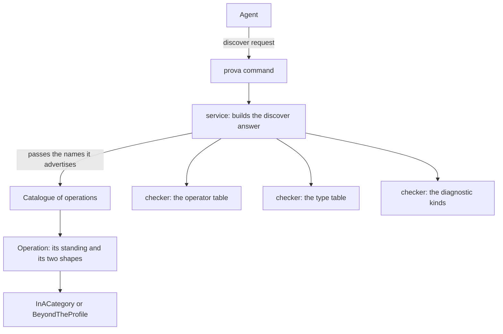

# F11 - design: who owns each part of the manifest

## The question this design answers

Three new parts must appear in the `discover` answer: the operation categories,
the request and answer shape of every operation an agent may call, and the types
and operators of the language. Each of them is a fact some module already
decides, or a fact nobody decides yet. The design puts each one with exactly one
owner, and keeps the dispatcher's diff to an import and three keys, because a
parallel delivery is editing the same dispatch.

## Who owns what

| Fact | Owner |
|---|---|
| Which operations exist, and whether each is available | `src/prova/service.py`, the two tuples it has today, untouched |
| Which category an operation covers, and which operations are this tool's own | `src/prova/manifest.py` (new) |
| The fields a request takes and the fields an answer carries | `src/prova/manifest.py` (new) |
| How many arguments an operator takes, how its operands are read, and the types it takes and answers | `src/prova/checker.py`, the operator table, extended |
| Which type names core-0 has, and what the values of each are | `src/prova/checker.py`, the type names, restated as one table |
| What a diagnostic of each category carries | `src/prova/checker.py`, reused unchanged |

Nothing is published from a second table. The object that refuses a wrong
operand is the same object that publishes the argument types of its operator,
and the table of type names the checker reads is the table the manifest prints.

**Legend.** An arrow means "asks, and prints what it gets back". `service` is the
only writer of the answer. `Catalogue`, `Operation` and the two standings are the
new module. The three `checker` tables already exist; only the first two learn
one new thing each.

**Text equivalent.** An agent sends a `discover` request to the `prova` command,
which asks the service for the answer. The service passes the operation names it
advertises to the catalogue; the catalogue holds one operation each, and every
operation carries one standing - either it is in one of SPEC.md's categories or
it is marked as this tool's own - and, when it is available, the shape of its
request and the shape of its answer. The service also asks the checker's three
tables (operators, types, diagnostic kinds) to publish themselves, and prints
all of it as one answer.

## What cannot be built wrongly

- A catalogue over a set of names different from the ones the dispatcher
  advertises cannot be built. The manifest can neither leave out an operation
  the tool answers nor advertise one it does not have.
- An operation's standing is one value, not two lists, so an operation that is
  both in a category and beyond the profile, and one that is in neither, cannot
  be built.
- An operation an agent may call carries both shapes; a refused one carries
  neither.

Two bindings are kept by generated laws rather than by construction, and are
claimed no more strongly than that: that the *kind* of value a published field
names is the kind the reader really refuses (LAW1), and that an answer carries
exactly the fields published for it (LAW2). The refusal messages belong to the
robustness work and are not rewritten here.

## Prefactoring first

The operator table says how many arguments an operator takes and the name of its
group; the operand rules stand in a chain of four branches reading that group
name. Before anything is published, the table learns its operand rule and its
result type as an object, and the branches become one question asked of that
object. The type names are restated the same way. No behaviour changes: every
refusal keeps its category, its sentence, its place and the two types it names;
the group names and the four sets stay exactly as the existing table test reads
them. This is a separate commit, before the feature commit, with no test edited.

## The owner's answers, recorded

- The types and operators are published under `language`, holding `types` and
  `operators`. The words *builtin* and *builtins* stay out of the answer, so the
  existing no-claim test stands unedited.
- `source` is published as optional, and acceptance criterion 4 is read as a
  rule about the kind of value a published field carries.

## Formal model

**No model for the published manifest.** The answer is computed from constant
tables inside one process. There is no shared state that two actors change, no
protocol with more than one step, no retry, no crash window and no progress
claim; every transition is one request in and one answer out, and the examples
and the three generated laws cover them. A model would restate the tables.

## What is still open

Nothing in the design. The craft step builds `manifest.py`, extends the two
checker tables in a prefactoring commit, and adds the three keys to the
`discover` answer.
