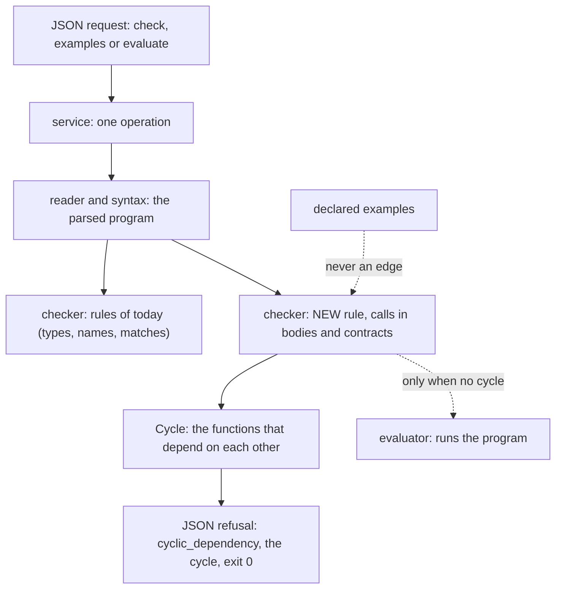

# F2 - Design: where a cyclic program is refused

## The decision in one sentence

The checker gains one more whole-program pass, beside the passes it
already runs, which builds the graph of calls written in function bodies
and contract clauses and refuses the program when any set of functions
depends on itself.

## Where each rule lives

| Rule | Who owns it |
|---|---|
| Which whole programs are invalid | `check_program` in `src/prova/checker.py`, as today |
| What a function depends on | new, beside it: the calls in its body and contracts |
| Which functions depend on each other | new, beside it: one search over that graph |
| What a reported cycle is | new value object `Cycle` in the same module |
| The vocabulary of categories, and the JSON shape | `src/prova/service.py`, as today |
| Printing one answer and exiting 0 | `src/prova/__main__.py`, unchanged |

Nothing is checked twice: the three operations (`check`, `examples`,
`evaluate`) already check the program before they evaluate anything, so
the crash recorded as defect 1 disappears without touching the evaluator
at all.

## Diagram: where is a cyclic program refused, and what is never reached?

**Legend.** A solid arrow is the path a request takes. A dotted arrow is a
path deliberately not taken: an example never contributes a dependency,
and the evaluator is reached only when no cycle was found.

**Text equivalent.** A JSON request reaches the service, which parses the
program once. The parsed program goes through the rules that exist today
and through the new rule. The new rule reads bodies and contract clauses
only; declared examples are never read by it. When it finds functions
that depend on each other, it builds a cycle, which becomes a refusal in
the JSON answer with the category `cyclic_dependency`, the members of the
cycle, and exit code 0. Only when it finds none does the evaluator ever
run the program.

## What is kept impossible by construction

- A reported cycle that names no function cannot be built: the value
  object refuses an empty list of members.
- A call written anywhere in a body or a contract is an edge, including
  in an expression kind added to the language later, because the walk
  follows the structure of the parsed nodes instead of a list of kinds
  that someone must remember to extend.
- A declared example is never an edge, because only the body and the
  contract clauses are walked.
- The search is iterative, so a program with more functions than Python
  allows nested calls is refused rather than ending the process - the
  very failure this feature removes.
- The answer is ordered by the program itself (members in declaration
  order, cycles by their first member), never by the iteration order of
  a set.

Honest limit: these hold because the code centralises the rule and
refuses at construction, not because a type checker proves them. The
language the tool checks still arrives as untrusted text, so this is a
check at the boundary, not a guarantee by type.

## Alternative rejected

Collecting the dependencies inside the pass that types expressions, which
already visits every call. It would make the two views of "what is a
call" impossible to disagree. It was rejected because it threads an
accumulator through about twenty recursive call sites of a function whose
one job is typing, and mixes a whole-program rule into a per-expression
one. The cost of the choice taken is a second walk over the same
expression trees; it is paid for by walking the node structure itself, so
a new expression kind cannot escape either walk.

## No formal model

No model for the acyclic rule: there is no shared state, no protocol with
more than one step, no concurrency and no crash window. The rule is a
property of one immutable parsed program, computed by a pure function,
and a generated property over call graphs observes it directly in the
ordinary test suite. (`quint` is also not installed in this environment,
but that is not the reason.)

## No refactor first

The code this change touches already separates the owner of the rule from
the adapter that publishes it, and the checker is already a sequence of
independent passes, so the new pass is added beside the others without
restructuring any of them.

One pre-existing matter is reported and deliberately not repaired here: a
diagnostic category is a plain string drawn from a closed published
vocabulary, which a type could own. Changing that would touch every
diagnostic and every test that reads one, far outside this request.

## Still open

Nothing. The three choices the person settled after the oracle step
(category name, machine-readable cycle field, exit 0) are carried into
this design unchanged.
