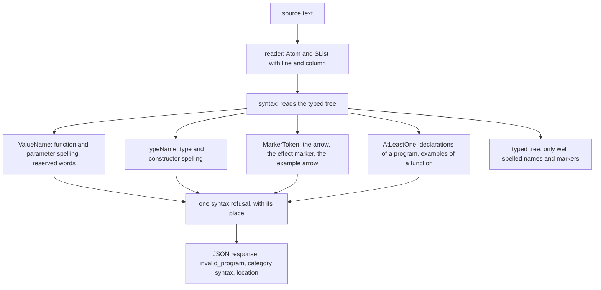

# F6 — design: who owns each spelling rule

## The decision

Every rule of this feature is a rule about the *source text*, so every one of
them is decided at the reader-to-tree boundary in `src/prova/syntax.py`, before a
tree exists for the checker to walk. Four small values own them:

| Value | Owns |
|---|---|
| `ValueName` | the shape of a declared function or parameter name, and the words the language reserves |
| `TypeName` | the shape of a declared type or constructor name |
| `MarkerToken` | the three reserved marker tokens, each at the one grammar position it stands at |
| `AtLeastOne` | a grammar repetition written with a plus: the declarations of a program, the examples of a function |

Each refuses its invalid spelling at construction, so a misspelled name or a
mangled marker cannot reach the typed tree at all. The refusal carries the line
and column the reader already holds.

`src/prova/service.py` gains one builder for a syntax diagnostic, which the four
operations that read source all call, so a refusal looks the same and carries its
place whichever operation met it. This follows the owner's answer: the
empty-source refusal applies at the shared boundary, to every operation that
reads source.

`src/prova/checker.py` is **not** touched. Spelling is a different question from
uniqueness and scope, and the delivery running beside this one owns that file.

## Diagram — where is each rule decided, from source text to response?

**Legend.** A box is a unit of the tool; an arrow means "hands its result to".
`ValueName`, `TypeName`, `MarkerToken` and `AtLeastOne` are the four new values;
the others already exist.

**Text equivalent.** Source text goes to the reader, which produces generic
nodes carrying a line and a column. The syntax reader builds the typed tree from
them, and at each name, marker and repetition it asks the owning value. Any of
the four values can refuse; a refusal becomes one syntax diagnostic carrying its
place, and the response is `invalid_program`. When no value refuses, the typed
tree holds only names and markers spelled as the language defines them.

## Reuse, and the alternative rejected

Reused: the existing `SyntaxError_` and the line and column it already carries;
the published `syntax` category; the `SPECIAL_FORMS` and `OPERATORS` sets already
defined in `syntax.py`, from which the reserved words are composed instead of
being written out a second time.

Rejected alternative: putting the name rules on the existing `DeclaredName`
value. It is built *after* a declaration is parsed, it never covers a parameter,
and it owns whether a name is declared twice. Spelling and uniqueness would then
share one owner and the parameter rule would have no home. Cost of the choice: a
declared name now passes two values, one for its spelling and one for its
uniqueness.

## Prefactoring first

The four source-reading operations each build their own syntax-diagnostic
dictionary from the same two fields. A first commit extracts them into one
builder with no behaviour change and no test edited; only then does the behaviour
commit add the location to that single builder.

## Formal model

No model for the spelling rules: they name no shared state, no multi-step
protocol, no concurrency and no crash window — each rule is a total function from
one source text to one answer, and the three laws it does claim are checked by
generated property tests in `tests/properties/test_f6_name_and_marker_spelling.py`.

## Still open

- The craft step writes the four values and the one builder, and must keep the
  three shipped programs accepted.
- `selfreview` needs an independent reviewer, which the host supplies.
