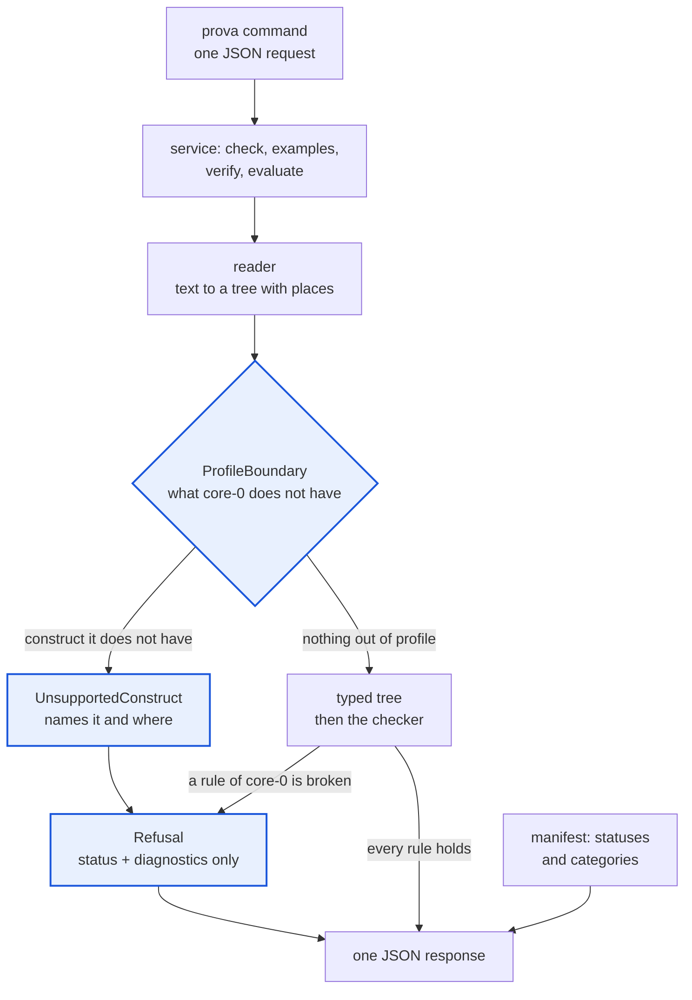

# F9 — the design: who decides that a construct is outside the profile

## The question the diagram answers

*Where is "core-0 does not have this" decided, and how does one decision reach all four
operations that read source?*

**Legend.** Blue, thick border: added by this feature. Plain: already there and reused
unchanged. A diamond is a decision; a rectangle is a thing that is built.

**Text equivalent.** The command hands one request to the service. Whichever of the four
source-reading operations was asked, the source goes through the reader, which turns the
text into a tree and records the line and column of every token. `ProfileBoundary` then
reads that tree *before* the typed tree is built. If it meets a construct `core-0` does
not have, it raises `UnsupportedConstruct`, which names the construct and where it
stands. Otherwise the typed tree is built and the checker runs as it does today. Both
kinds of refusal — out of profile, and a rule of `core-0` broken — are turned into a
response by one `Refusal`, which carries a status and diagnostics and has nowhere to put
a claim, a result or a digest. The manifest publishes the statuses and the categories a
caller may meet.

## Why the boundary is read before the typed tree

SPEC.md (51–54) requires an unsupported feature to be identified as unsupported and not
misdiagnosed. That is only possible if nothing else answers first. Today the decimal
literal `1.0` is met by the value reader, which calls it "not a value"; `/` is met by the
checker, which calls it an undeclared function. Reading the boundary over the reader's
tree, in the one call every source-reading operation already makes, puts the honest
answer ahead of both — by construction, not by ordering luck in four places.

It also means one scan answers in source order, so the refusal a reader gets is for the
first out-of-profile construct in their file.

## Why one `Refusal` owner

The four operations each repeat the same four steps today, and each builds the same two
refusals. Adding a status there would mean writing it four times, and three of them
could drift. The prefactor commit extracts that repetition first, behaviour unchanged
and no test edited; the feature commit then adds the new status once. That is what makes
"all four operations answer an out-of-profile source identically" true by construction
rather than by four copies happening to agree.

`Refusal` holds a status and its diagnostics and nothing else. There is no field for a
claim, a result or a source digest, so the fifth acceptance criterion — an unsupported
answer claims nothing about the program's deeper meaning — cannot be broken by a later
edit without adding a field first.

## The five invariants and what each one costs

| # | Invariant | How it is held |
|---|---|---|
| INV1 | an out-of-profile source never reaches the typed tree or the checker | the boundary is read first, inside `parse_program` |
| INV2 | all four operations answer it identically | one `Refusal` owner builds the answer |
| INV3 | the answer carries no claim, result or digest | `Refusal` has no field for them |
| INV4 | every refusal names its construct and its place | `UnsupportedConstruct` refuses to be built without them |
| INV5 | nothing else gets the new status | the boundary names a closed set of constructs |

INV1 has one stated bypass: a caller that reads a value with `parse_value` rather than a
program with `parse_program` is not scanned. That is the `evaluate` argument path, and it
keeps its `malformed_value` refusal on purpose (DEC7) — an argument is not source.

## What was rejected, and what the choice costs

**Rejected: treat every top-level form that is not a declaration as an out-of-profile
expression.** Simpler, one rule, no lookup. Rejected because `(deftypo T ...)` would then
be answered "wait for a later profile" when the repair is one letter — the same
mislabelling this feature exists to remove, pointing the other way. The cost of the
narrow rule is that `ProfileBoundary` must first collect the function names the source
declares, and that a trailing call to a function the source does *not* declare keeps
today's refusal.

**Rejected: refuse `Decimal` and `Text` wherever they are written as type names.** It
would cover more of the profile boundary, but a program may legally declare a record
named `Decimal` today, and refusing the spelling would make a valid program invalid. The
cost: a signature that names `Decimal` with no decimal literal in it is still answered
`unbound_type`. Named as a limit, not hidden.

**Rejected: a formal model.** The change is a pure function from one source text to one
response. No model for the profile boundary: there is no shared state, no multi-step
protocol, no concurrency and no crash window for a model to describe. The law that it is
total — every source gets one answer — is checked by the generated properties instead.

## What is still open

- The manifest lists the five statuses `service.handle` answers with. The command wrapper
  adds `tool_failure` when the request itself is not JSON, and that one is not published:
  it belongs to the command, not to the service.
- Only the first out-of-profile construct in a source is reported. A reader repairing a
  file with several must run the tool again after each.
