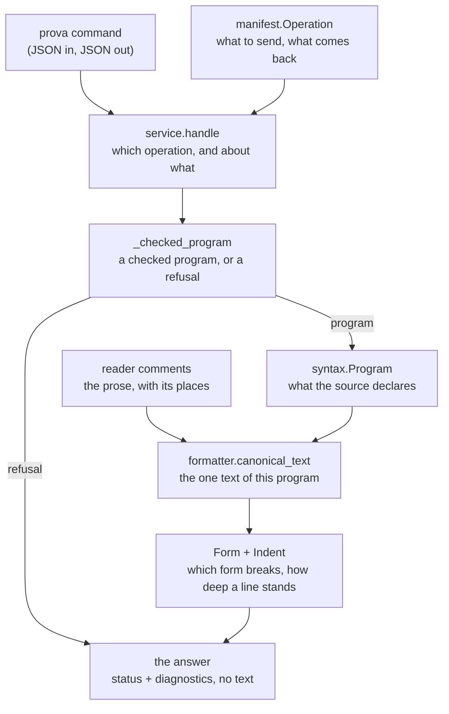

# F15 design — who decides what, when a program is written out

## The shape of the change

One new module, `src/prova/formatter.py`, answers one question: what is the
canonical text of a program? It is handed the typed tree the tool already
builds and the comments the reader already keeps, and it hands back characters.
It never sees a request, a status or a diagnostic, and it reads no character of
the submitted source — which is what makes writing a program out twice give the
same text.

Everything else is reuse. `service.py` moves `format` out of the refused
operations into the two tables that already say what it answers, and gains one
runner beside its siblings. `manifest.py` gives `format` the two shapes an agent
reads instead of refusing to publish any. Nothing else changes.

## The diagram

**Question it answers:** when the Owner asks for the canonical text of a
program, who decides what?

**Legend.** A box is a thing that decides something; its second line says what.
A solid arrow means "hands its answer to". The two labelled arrows out of
`_checked_program` are the only fork: a source that is not a program never
reaches the formatter at all.

**In words.** The command reads one JSON request and gives it to `service.handle`,
which decides which operation was asked for — reading what an agent may send
from the manifest. Every operation that reads a source goes through
`_checked_program`, the one rule that turns characters into a checked program or
into a refusal. A refusal becomes an answer with a status and diagnostics and no
text at all. A checked program, together with the comments the reader kept, goes
to `formatter.canonical_text`, which builds one `Form` per parenthesised form of
the program and asks each one how it is written; `Indent` answers how deep each
line stands. The characters come back as the answer's result.

## The decisions, and what they cost

**One new module, not a new method on `tree.py`.** `tree.py` answers the JSON
tree an agent reads, where a part carries its place as two numbers and never as
a column on a page. Putting the layout there would make one module answer two
different questions about the same tree. Cost: one more file, and a second
walk over the typed tree.

**`Form` decides, not the caller.** A parenthesised form is written on one line
unless it holds a `let`, an `if` or a `match` anywhere inside it; then its head
and — when that part fits on one line — its first part stand on the opening
line, and the rest each start a line two columns further in. A `defn` and a
`let`, `if` or `match` always break; an `examples` clause always breaks with one
example per line. Nothing measures a line width, so the text is a function of
the tree alone. Cost: a long operator call stays long.

**Rejected alternative: a width-aware layout.** The usual formatter breaks a
line when it passes a column limit. It reads better and it makes idempotence a
property to be argued rather than one that follows: the decision then depends on
the text produced so far, not only on the tree. For a tool whose promise is "the
same text every time", the simpler rule is worth the uglier long line. The cost
of the choice is readability on wide expressions, and it can be revisited
without changing any promise.

**Reuse of `AttachedComments`.** The object that already decides which comment
stands before which thing, for the published tree, is asked again here — at each
declaration rather than at each node. So there is no second rule about where a
comment belongs.

**The prefactor.** `tree.py` works out the order a source writes its
declarations by reading `Program`'s two lookup tables from outside. The
formatter needs the same order. Rather than copy it, one commit before the
feature moves that decision onto `syntax.Program` as `in_source_order()` and
leaves `tree.py` calling it. Same declarations, same order, same tuple: no test
changes and none is edited.

## No formal model

`No model for "the canonical text of a program is canonical already": there is
no shared state, no protocol with more than one step, no concurrency window and
no crash window.` Writing a program out reads one text, keeps nothing and writes
no file; asking twice changes nothing anywhere. The law that remains — that
writing out is idempotent and preserves meaning — is a law over a pure function,
and it is searched for counterexamples by generated property tests against the
real tool through its real port.

`quint` is not installed on this machine (`quint: not installed`), so the
model-checked option was not available in any case. That is recorded as a
capability limit, not as a check that passed.

## What is open

One question for the Owner, at this pause: where a comment written *inside* a
declaration should end up. It is stated in the report with its options.

## What this step does not claim

No code is written yet. Nothing here shows the layout is implementable as
described; the three published pairs were computed by hand from these rules, and
the craft step must make the tool agree with them or the pairs are wrong.
