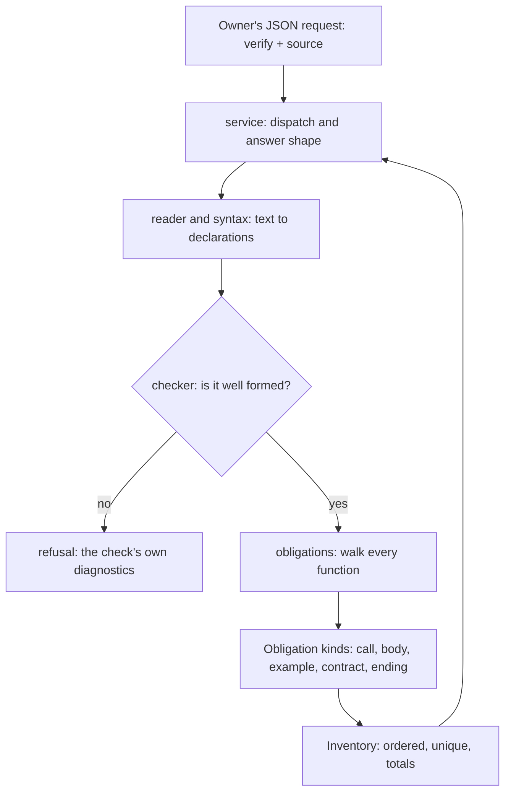

# Design: who decides what a program owes

## The one rule that has no owner today

Nothing in the tool decides *which obligations a program owes*. The reader and
the syntax tree turn text into declarations; the checker decides whether a
program is well formed; the evaluator runs it. None of them answers "what would
have to be shown about this?".

So one new module owns that rule: `src/prova/obligations.py`. Everything else is
reused as it is.

The nearest look-alike is `checker._calls_in`, which the parallel cycle-check
delivery added. It answers a different question -- does any call cycle exist --
drops the condition that reaches a call, is private, and lives in a file this
change may not edit. It is not extended.

## Diagram: who decides what, when the Owner asks what a program owes?

**Legend.** A rectangle is a decision owner; the diamond is the gate that
decides whether the question can be answered at all; an arrow is "hands its
result to".

**In words.** The Owner's request reaches the service, which owns the answer's
shape and nothing about obligations. The text becomes declarations, and the
checker decides whether the program is well formed. If it is not, the Owner
reads the same refusal the whole-program check gives. If it is, the obligations
module walks every function and builds one obligation of the right kind for each
call, body, declared example, contract and function ending. The inventory holds
them in declaration order, refuses two with the same identity, and answers its
own totals. The service wraps that value in the envelope `check`, `examples` and
`evaluate` already use.

## Types, and what each one refuses

| Type | What it owns | What it makes impossible |
|---|---|---|
| `Obligation` and its five kinds | what must be shown, and the identity that names it | an obligation with any result but `not_attempted`: the result is a constant of the type, not a constructor argument |
| `PathCondition` | the branch and match conditions on the way to a call | reporting `true` for a call that sits inside a branch |
| `Site` | where in a declaration the obligation arises | an identity that moves when the program is reformatted: the site is structural, never a line number |
| `Inventory` | the obligations in declaration order | two obligations with one identity; counts that do not add up to the list |

The five kinds are the ones SPEC.md names: a precondition obligation per
potentially evaluated call, one connecting each function's body to its
postcondition, and separate records for example validity, contract definedness
and structural termination.

## What was decided, and what it costs

- **Paradigm: objects, in the shape this repository already uses.** Immutable
  values (frozen dataclasses) that answer about themselves, one class per
  obligation kind instead of a kind flag the renderer would branch on, and a
  module-level entry point, as `reader`, `syntax` and `checker` have.
- **The service keeps its duplicated preamble.** The parse-and-check prelude is
  now written a fourth time rather than extracted. The cost is real duplication
  in `service.py`; the reason is that the request limits this change to the
  smallest one in that file while another delivery is in flight. The extraction
  is the follow-up this design owes.
- **Rejected alternative: build the inventory inside the checker**, where the
  call walk already exists. It would put a second responsibility into a file
  this change may not edit, and tie the list of obligations to the pass order of
  a static check that answers a different question.
- **No formal model.** No model for the inventory's completeness, determinism
  and condition laws: there is no shared state, no multi-step protocol, no
  concurrency and no crash window anywhere in the operation -- it reads the
  request's source text and returns a value. The laws are checked instead by
  four generated property tests over the real command.

## Still open

Nothing in this design attempts an obligation, and nothing here says a program
is in any state. Whether the obligations are the *right* ones for a solver to
discharge is the next feature's question, not this one's.
