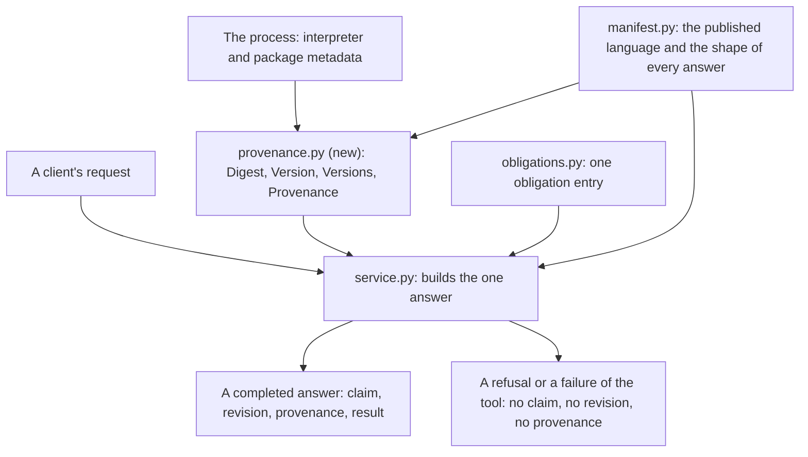

# F17, step 2 of 5: the design

## The question this design answers

Where does what an answer stands on come from, and who owns each part of
it?

## The shape of the change

**Legend.** A box is a module or a thing outside the code; an arrow means
"gives what it owns to". Nothing points back into `provenance.py`: it
reads the process and the published language, and nothing reads it except
the place that builds an answer.

**In words.** A request reaches `service.py`, the only place that knows
operation names. To build a completed answer, `service.py` asks
`provenance.py` what this tool is made of; `provenance.py` reads the
interpreter and the package metadata of the process, takes the published
language from `manifest.py`, and answers one object: a digest over all of
it and the four versions. `manifest.py` also tells a client which
operations carry that object. An obligation entry comes from
`obligations.py`, which now carries two fields instead of one. An answer
that refused a program, and an answer that reports a failure of this tool
itself, get none of it.

## What was decided, and why

| Decision | Reason |
|---|---|
| A new module `provenance.py` | No module owns what this tool is made of. Putting it in `service.py` would make the dispatcher decide facts about the tool; putting it in `manifest.py` would make the catalogue of operations read the environment. |
| It also owns the SHA-256 of a text | Two things are hashed now: the submitted source and this tool's own description. One place writes that algorithm; `SourceRevision` keeps its meaning and delegates. |
| A version is built two ways and no other | A version used and a version that does not apply are different facts. Each constructor refuses an empty text, so a name with nothing beside it cannot be built. |
| Exactly four versions, held as one collection | SPEC.md lines 270-284 name four. A collection built from another set of names refuses, so an answer cannot quietly drop one. |
| An obligation gains `execution_status` beside `result` | SPEC.md fixes two vocabularies that share no word. Both stay constants of the type: no caller can set either. |
| A failure of the tool is answered at the boundary that prints the answer | It is the one place every answer passes. The status stays outside the list of statuses an answered request carries, which two accepted tests require and the manifest already explains. |
| No formal model | This change adds no state, no protocol, no concurrency and no crash window: every answer is one function of one request. |

## The prefactoring, first and on its own

One commit before the feature moves the SHA-256 out of
`service.SourceRevision` into `provenance.Digest`, with `SourceRevision`
delegating. Same algorithm, same characters, same text rendered; no test
edited, no answer field added.

## The gap the owner accepted

The `evaluate` operation keeps the answer it has today, with no
provenance block. It is this tool's own extension, named in none of the
operation categories of SPEC.md, and an accepted test pins its answer to
six fields. The manifest documentation and the handoff say so plainly, so
a client reading the shapes is not left to discover it.

## What this design does not decide

Nothing about a solver or an encoder: both are recorded as not
applicable, with the reason that this tool has neither.
