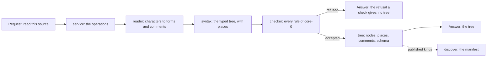

# F12 design: where the published tree comes from

## The question this answers

When an agent asks to read a program, which part of the tool builds the
tree it is answered with, and who owns each rule along the way?

**Legend.** A solid arrow is a step of one request. A dotted arrow is a
table read, not a call per request. Boxes named after a file are the
owner of that rule.

**The same in words.** A request reaches the operations in `service.py`.
It reads the source through the one request reader, hands the characters
to `reader.py`, which answers the forms and the comments it met.
`syntax.py` builds the typed tree from the forms, carrying the place of
each one. The checker reads every rule of core-0 over it. A source that
breaks a rule is refused exactly as a check refuses it, and no tree is
published. A source that passes is turned into published nodes by the new
`tree.py`, which also publishes the table of kinds that the manifest shows
under `discover`.

## What is reused and what is new

Reused: the reader, the typed tree, the shared rule that refuses a source
the same way for every operation, the table of declared names (for the
place of a field), the value renderer for the text of an example, and the
manifest.

New: `src/prova/tree.py`. No module owns a published interchange format
today. `syntax.py` owns the tree the checker walks and must not learn a
wire format; `service.py` owns operations and answers, not the shape of a
tree. `reader.py` gains the comments it already meets and throws away
today, because it is the only place that reads characters.

## Invariants this change must keep

| # | Invariant |
|---|---|
| INV1 | Every published node carries the place of the form it was read from. |
| INV2 | The kinds the manifest publishes are the kinds the builder answers: one table. |
| INV3 | Every comment is published exactly once, on the first node after it, or at the document end. |
| INV4 | A tree is published only for a source that passed every rule, so a refusal carries none. |
| INV5 | A comment keeps the characters it was written with, from its `;` to the end of its line. |

## Refactor first

Yes. The typed tree keeps a declared parameter and a `let` binding as bare
pairs of strings, and its declarations, signatures, examples, match
clauses and patterns carry no place at all. Those come first, in commits
that change no answer the tool gives and edit no test. A record field
keeps its pair, because an existing test pins that shape by equality; its
place is read from the table of declared names instead.

## Still open

Nothing in the design. The one conflict (the manifest expectation) was
answered by the owner and is committed on its own.
