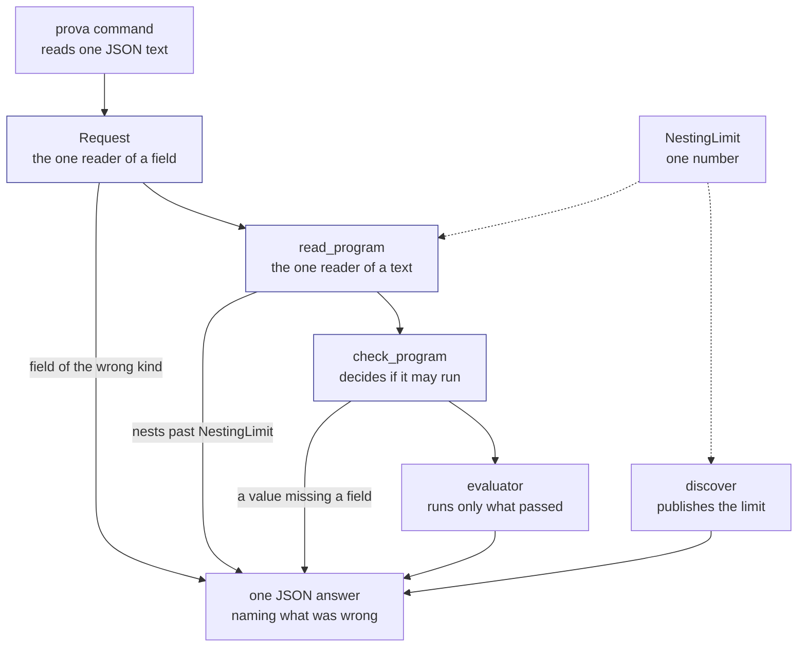

# Robustness R1 - the design

## The one question this design answers

Where does each crashing input get refused, so that it is refused once
and in the place that owns the rule?

**Legend.** Boxes with a blue fill are the three gates, each the only
place its rule is decided. A solid arrow is the path a request takes. A
dotted arrow means "reads the number from". Every path ends at one JSON
answer.

**Text equivalent.** The command reads one JSON text and hands it to
`Request`, the only thing that reads a field of it. A field of the wrong
kind is answered there. What survives goes to `read_program`, the only
thing that turns a text into a tree and so the only place nesting grows;
a text past `NestingLimit` is answered there. What survives goes to
`check_program`, which decides whether the program may run; a value
written without one value per declared field is answered there. Only
then does the evaluator run. `NestingLimit` holds the number once and
both the reader and `discover` read it from there, so the number
published and the number enforced cannot drift apart.

## What is reused and what is new

| Reused | Why it fits |
|---|---|
| The table of diagnostic kinds in `checker.py` | It already refuses a category no kind declares, so the new category must state its shape where a caller reads it |
| The `arity_mismatch` category with its two counts | It already says a declared thing takes one number and was given another; the same defect in an expression already uses it |
| The table of statuses in `service.py` | It is what `discover` publishes |
| `resolve_constructor` in `syntax.py` | It already answers what a constructor is |
| The request check F10 opened for `source` | The new reader absorbs it rather than standing beside it |

| New | Why no existing owner fits |
|---|---|
| `NestingLimit`, `TooDeeplyNested` in `reader.py` | Nothing declares or enforces a budget anywhere today, and the reader is the one place depth grows |
| `Request`, `FunctionName`, `ArgumentTexts` in `service.py` | Every handler reads raw fields itself today; one field has a check and the rest have none |
| `DeclaredConstructor` in `syntax.py` | The fact it answers is decided in two places that do not know about each other |

## What is prepared first

One behaviour-preserving commit comes before the feature. The number of
fields a constructor declares is compared in two places today - the
checker's rule over an expression, and the evaluator's check of a value
a request supplies - and the new rule would be a third. That fact moves
into `DeclaredConstructor` and both existing callers ask it. The
messages, counts and categories they produce do not change, no test is
edited, and the suite stays green.

## What must stay true

| | Rule | Where it is kept |
|---|---|---|
| 1 | No text is read into a tree deeper than the published limit | `NestingLimit` |
| 2 | The number published and the number enforced are one number | `discover` reads it from the limit |
| 3 | No handler reads a raw request field | `Request` |
| 4 | Evaluation is reached only with a name and texts already proven | `FunctionName`, `ArgumentTexts` |
| 5 | A value carries one value per declared field, or the program is refused | `check_program` |
| 6 | One object answers how many fields a constructor declares | `DeclaredConstructor` |

Rule 3 gets an architectural check over the whole service module, not a
list of handlers, so a handler added later is governed too.

## The alternative that was rejected

The limit could have been enforced by raising Python's own recursion
limit and catching the error. That was rejected: the margin would then
depend on how deep the caller's own stack already was, the refusal would
carry no place to open, and no number could honestly be published.

## What this design does not claim

The limit is enforced where a text is read. A program with very many
declarations, each shallow, can still make the evaluator call itself
once per declaration; nothing here bounds that, and no input found by
the sweep reaches it. It is named here so that it is not mistaken for
covered.

Nothing here is proved. The construction of a function name and of the
argument texts is centralised, not proved: Python lets a caller build
those objects around any value by hand. The claim is that the service
has one path and that path refuses.

## No formal model

Every behaviour is one request answered by a pure function. There is no
shared state, no protocol with more than one step, no retry, no crash
window and no actor that can change what another reads, so there is no
state space a model would explore. The laws that do exist are over
inputs, and the generated properties check them directly.

## Two decisions recorded after the first review

**A request that cannot be read is answered before the program is.**
When a field of the request is unreadable and the source is also
broken, the answer names the field, not the program. A request that
cannot be read is not yet a request about a program, so there is
nothing to report about one; and the field is the thing the client can
repair. The visible change: a request with no `function` and a broken
`source` used to be answered `invalid_program` with a `syntax` refusal
and is now answered `invalid_input` with a `malformed_request`.

**The evaluator counts steps, not calls.** The review asked for a limit
on how deep a chain of calls may go. The limit counts every evaluation
step standing inside another instead, calls among them. Counting calls
alone would leave the stack unbounded: the expression written inside
each call is still standing when the next call is made, so a short
chain of deeply written functions would exhaust the stack while every
count stayed under its own limit. One stack is bounded by one number.

## What this design does not claim

The two limits bound the stack. They say nothing about memory or time:
a program inside both can still build a very large value, and nothing
here measures how long a run takes. The frame counts behind both
numbers were measured on the Python this repository pins; another build
would need them measured again.
