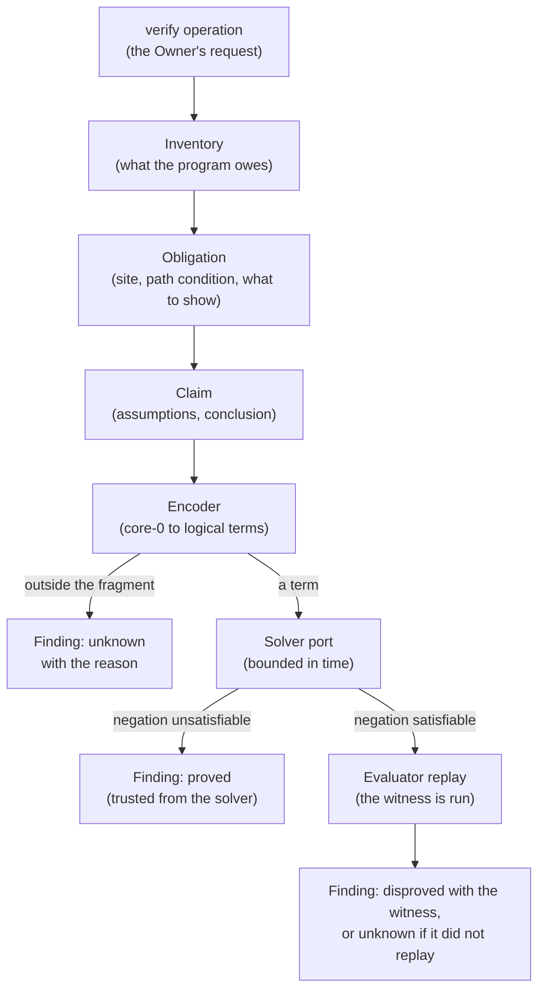

# F18 — the design: how an obligation becomes proved

## The question this answers

An obligation is a sentence about a program. A solver answers questions
about formulas. This design says what each part of `core-0` becomes as a
formula, why settling the formula settles the sentence, and what happens
to everything the translation does not cover.

## The path one obligation takes

**Legend.** A box is a unit that decides something. An arrow is "hands
its result to". A labelled arrow is the outcome that takes that path.

**In words.** The `verify` operation asks the inventory what the program
owes. Each obligation states its own claim: the things that may be
assumed, and the one thing to be shown. The encoder turns that claim
into logical terms, or refuses it by name, and a refusal is already the
answer: `unknown`, with the reason. A term goes to the solver port,
which is bounded by the time the run has left. If the negation of the
claim is unsatisfiable, the obligation is `proved` — on the solver's
word, which this tool does not check again. If the negation is
satisfiable, the solver's model is turned back into values of the
program and **run through the tool's own evaluator**: only an input the
evaluator really refuses becomes a `disproved`; anything else is
`unknown`.

## The fragment, construct by construct

Everything below is what the two shipped examples need, and nothing
more. Each row says what the construct becomes and the premise that
makes the translation faithful to the evaluator in `src/prova/evaluator.py`.

| Construct | Becomes | Why that is faithful |
|---|---|---|
| `Int` and its literals | the mathematical integers | SPEC.md: `Int` is arbitrary precision and must not silently overflow. The evaluator uses Python integers, which are unbounded. No width, no wraparound, on either side. |
| `+`, `-`, `*` | sum, difference, product | the same total operations on the same numbers. `*` only where one operand is a literal; see below. |
| `<`, `<=`, `>`, `>=` | the order of the integers | the same total relation. |
| `=` | equality of the two encoded values | core-0 equality is structural, including every constructor field; the datatypes below are freely generated, so their equality is structural too. |
| `and`, `or`, `not` | conjunction, disjunction, negation | core-0 short-circuits left to right. Short-circuit and strict evaluation agree for every total, effect-free expression, and `core-0` has no partial primitive, no effect and no divergence inside this fragment — so the strict connectives mean the same thing here. Division, the one operation that would break this, is not in the profile. |
| `Bool`, `true`, `false` | the booleans | two values on both sides. |
| `Unit`, `()` | a type with one value | one value on both sides. |
| a record type | a datatype with one constructor, one field per declared field | fields are typed and the type graph is acyclic in `core-0`, so the datatype is non-recursive and every value is one application of that constructor. |
| a union type | a datatype with one constructor per variant | the same: distinct variants are distinct values, and every value is of exactly one variant. |
| a constructor call | an application of that constructor | the evaluator builds the same value. |
| a field selection | the accessor of that field | selection is defined only on records and is resolved from the operand's type by the checker, so the accessor is applied to a value of its own constructor. |
| `if` | if-then-else | the evaluator takes exactly one branch; both are checked and total, so the value is the same. |
| `let` | substitution of each initializer, in order | initializers are evaluated in order and are total; no binding shadows a visible one. |
| `match` | a chain of if-then-else on the recognizers and literals, in source order, with the last clause as the final alternative | first matching clause wins, which the chain preserves; and the checker has already shown the match exhaustive, so the final alternative is reached only by values the last clause matches. |
| a pattern | a recognizer and, for its variables, the accessors that reach them | a pattern variable binds once per pattern, so each one names one accessor path. |
| a call to a declared function | the callee's body, substituted | SPEC.md names inlining a valid initial strategy. The call graph of bodies and contracts is acyclic in `core-0`, so expansion ends. |

**Multiplication.** SPEC.md: multiplication is linear only when one
operand is a known integer constant. A product of two unknown numbers is
executable `core-0` and outside the automation required here, so it is
refused: `unknown`, with the reason. It is never handed to the solver
anyway.

**Everything else** — any construct not in this table, an expansion that
grows past its bound, a type the translation has no datatype for — is
refused the same way, by name. The encoder has exactly one way to
decline, so nothing is dropped quietly.

## Why a discharged obligation is the claim the source makes

The translation above defines a **total** reading of a `core-0` program:
every well-typed expression denotes a value, because the profile has no
partial primitive, no effect and no non-terminating call. The evaluator
agrees with that reading wherever it returns a value at all; where it
differs it does not return a wrong value, it refuses the call, and a
refusal is not a counterexample to anything.

So for each kind of obligation:

- **a body against its postcondition** — the claim is: for every input of
  the declared types, if the function's own precondition holds, the
  postcondition holds of the body's value. Proved over the total reading,
  it holds of every run that returns a value. That is exactly what the
  Owner is promised.
- **a call's precondition** — the claim is: wherever the condition that
  reaches the call holds, the callee's precondition holds of the
  arguments. The condition that reaches it is the one the inventory
  already carries, built from the function's own `requires` and from
  every branch and clause on the way down. It is **assumed**, not shown,
  and it is what makes a guarded call provable while the same call with
  nothing in front of it is not.
- **a declared example** — the claim is: the arguments meet the
  precondition and the body's value at those arguments is the one stated.
  The arguments are closed, so this is a formula with no free variable.
- **a contract's definedness** and **a function's structural ending** are
  not sent to a solver at all. They follow from the profile: core-0 has
  no partial primitive, and the checker has already refused any program
  whose body-and-contract dependency graph has a cycle. These two are
  marked `structure` rather than `solver`, so a reader can see which
  claims rest on a rule and which on a solver's word.

A call is **inlined**, never replaced by an assumed postcondition.
SPEC.md allows the assumed form only with independently established
callee obligations and a justified modular proof rule; this delivery
builds neither, so it does not use it.

## How the three answers are decided

An obligation's claim is `assumptions implies conclusion`. It is valid
exactly when `assumptions and not conclusion` is unsatisfiable. The
solver is asked that one question.

| The solver says | The answer | The execution status |
|---|---|---|
| unsatisfiable | `proved` | `completed` |
| satisfiable, and the witness is refused by the evaluator | `disproved`, with the witness | `completed` |
| satisfiable, and the witness is **not** refused | `unknown`, saying the candidate did not replay | `completed` |
| unknown, out of time | `unknown` | `timed_out` |
| unknown, for its own reason | `unknown`, with that reason | `completed` |
| nothing was asked: outside the fragment | `unknown`, with the construct named | `unsupported` |
| nothing was asked: the solver could not be loaded | `unknown`, naming the missing solver | `tool_failure` |

The witness is the solver's model read back as values of the program,
written the way a program writes them (`-1`, `(Clock 13)`, `(Tick)`), so
the Owner can paste them straight into a run. SPEC.md requires a
validated source-level witness for a disproof and says that a failed
validation yields unknown, not an invented disproof — that is the fourth
row above, and it is also the hook the next feature needs.

## The solver, its time and its loading

The solver is a pinned Z3, the `z3-solver` package, at one exact
version in `pyproject.toml` and in `uv.lock`. It is imported **inside**
the call that asks it, never at module level, for three reasons: no
other operation pays for loading it; a refused `build` request still
enters no solver work, which an existing property test watches from
outside; and a machine without it answers `unknown` with
`tool_failure` instead of failing the whole tool.

The run's own time budget bounds the solver twice. Between obligations
the run is asked whether its time is up, exactly as the `examples`
operation already asks before each declared example; if it is, the whole
answer is the time-budget refusal that F14 already defines. Within one
obligation, the solver is given what the run has left, so a query can
never outlive the budget: a query that runs out answers `unknown` with
`timed_out`, and a run with nothing left does not ask at all.

## The formal model

A model **is** warranted in principle: the soundness of the translation
is a law over a pure function, which the method says to check with a
checker rather than with examples alone. **Quint is not installed on
this machine**, so that check cannot be run here. This is recorded as a
capability limit, not as a pass: the claim stays `INDETERMINATE` as far
as model checking goes.

What stands in its place is evidence of a different kind, and the
documents must not confuse the two: five generated laws drive the real
command, the strongest of which runs every program whose promise came
back `proved` through the tool's own evaluator and requires the two
never to disagree. That is a search for counterexamples over a bounded
set of generated programs. It is not a proof, and nothing in this
delivery should be read as one.

## Reuse, and the one thing prepared first

Nothing here re-decides something the repository already owns. The
inventory, the path conditions, the evaluator, the budgets, the manifest
and what an answer stands on are all existing owners and are called
where they stand. Three new units are added because no existing one
answers their question: what a construct means logically, how a solver
is asked, and how the three answers are decided.

One thing is prepared first, in a commit of its own that changes no
behaviour: the condition that reaches a site is held today as text. Text
cannot be translated. It becomes the conditions it already is — a
holding, a failing, a matching or a not-matching of an expression — each
of which still writes itself out exactly as it does today, so every
reported condition is unchanged, character for character, and no test is
touched.

## What stays open after this step

- Whether the pinned wheel installs in CI on Linux.
- The expansion bound's number: it is chosen, not measured, and will be
  stated where the other budgets are stated.
- The five superseded expectations, which are repaired one commit each
  after the behaviour lands.
