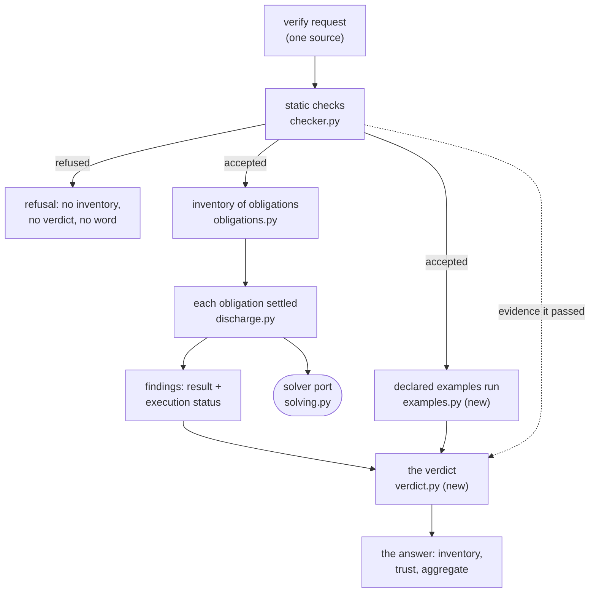

# F21 — the design: where one word comes from

The Owner settled both open questions at the oracle pause:

- the two tests that forbid the word are re-aimed exactly as F18 re-aimed
  them for `proved` — the word is allowed only where the fields that
  justify it are published, and the manifest states the three conditions
  in full; each edit in its own commit, each keeping its protective
  intent, so that a tool publishing `verified` while an obligation is
  `unknown` or `disproved`, or while an example fails, still turns a test
  red;
- a solver that cannot load is the aggregate's own
  `execution_status: tool_failure` beside `result: not_verified`. The
  answer's status stays `completed`, and the manifest says so.

## Where the word comes from

**Legend.** Rectangles are units of this tool; the rounded one is the
port to the pinned solver; the dotted line carries evidence, not data; a
labelled arrow is a branch.

**Text equivalent.** A `verify` request is read and checked. If the
checker refuses it, the answer is that refusal: there is no inventory, no
verdict and the word is never used. If the checker accepts it, three
things happen to the same program: its obligations are listed and each is
settled through the solver port or by a rule of `core-0`; its declared
examples are run; and the fact that the static checks passed becomes a
piece of evidence. The verdict is computed from exactly those three and
from nothing else, and the answer carries it beside the inventory it
rests on.

## The one pure function, and its closed table

`Verdict.over(findings, examples, static_checks)` is the only place the
word is produced. It reads no clock, no file and no solver; it is a
function of its three arguments.

It says `verified` when, and only when:

1. the inventory is not empty and every finding's result is `proved`;
2. every declared example was run and passed;
3. the evidence that the static checks passed is present.

Anything else is `not_verified`, with a reason listing what blocked it:
the identities of the obligations that are not discharged, and the
examples that did not pass or were not run.

Beside the word it carries what happened to the attempt. Each obligation
already says that for itself; the verdict carries the most serious of
them, in this fixed order:

`tool_failure`, `invalid_input`, `resource_exhausted`, `cancelled`,
`timed_out`, `unsupported`, `completed`.

A failure of this tool outranks a limit this tool stopped at, which
outranks a question it declined to translate, which outranks an attempt
that finished. That is how a solver that cannot load reaches the Owner as
`not_verified` beside `tool_failure`, which is what the Owner asked for.

The eleven rows of the table are written out by hand in
`tests/unit/test_f21_the_aggregate_is_one_closed_table.py` and three laws
over generated programs stand beside them in
`tests/properties/test_f21_aggregate_laws.py`.

## What cannot be built

The three conditions are not three branches someone could forget.

- `StaticChecksPassed.of(diagnostics)` answers with the evidence only for
  an empty list of diagnostics, and `Verdict.over` takes that evidence as
  an argument. A program the checker refused cannot have a verdict
  computed for it at all, in any caller.
- `ExamplesRun.of(entries, declared)` refuses a run that does not cover
  every declared example. A run the evaluation depth budget stopped is
  built by `ExamplesRun.stopped_at(...)` instead, and that value never
  reports a pass it did not see.
- A finding that pairs `proved` with an attempt that did not complete is
  refused loudly rather than counted as discharged. No constructor of
  `discharge.Finding` builds that pair; the refusal is there for the
  caller that builds one by hand.
- The word itself is produced nowhere but inside `Verdict.over`; the
  value has no setter and no public constructor that takes it.

## What an unsupported function elsewhere does

Nothing is removed. An obligation the translation declines is still
listed, still carries its own `unknown` and its reason, and is counted
among the undischarged by the verdict — which is how it withholds the
word. The obligations of every other function keep the results they had.
This is checked over generated programs, not only over a fixed example.

## What stays visible

The verdict counts the obligations a rule of `core-0` settled apart from
the ones a solver answered, and the two counts add up to what was
discharged. An entry already says which of the two settled it; the
counts say it over the whole, so a reader can see at a glance how much of
a `verified` rests on a solver's word.

## Prefactoring, first and on its own

Running the declared examples is a fact one unit must own. Today it is
decided inside the `examples` operation in `service.py`. Before `verify`
uses it, that run moves into its own unit with no change of behaviour and
no test edited; the `examples` operation then reads it from there.

The two operations keep their own answer to a run the evaluation budget
stops: `examples` refuses, as it does today, because running them is what
it was asked for; `verify` treats it as one input to the verdict and
answers `not_verified` beside `resource_exhausted`, because it was asked
for the inventory and that is still there to give. This keeps the answer
F18 already observes for a chain too deep to replay.

## Formal model

No model for the verdict: it names no shared state, no multi-step
protocol, no concurrency and no crash window — it is a pure function over
one answer's own findings, and its law is checked by the closed table and
by three generated properties.

## What this design costs

The rejected alternative was to read "all examples pass" off the
`example_validity` obligations, which are already settled. It costs
nothing to compute and would have needed no new unit — but it would let a
solver's word about an example stand in for the example having been run,
and SPEC.md keeps the kinds of evidence apart: "No evidence kind silently
upgrades another kind." The cost of the chosen design is that `verify`
now runs the declared examples, so it does the work the `examples`
operation does, and a program too deep to run them reaches the Owner as
`not_verified` where it used to carry an inventory alone.
